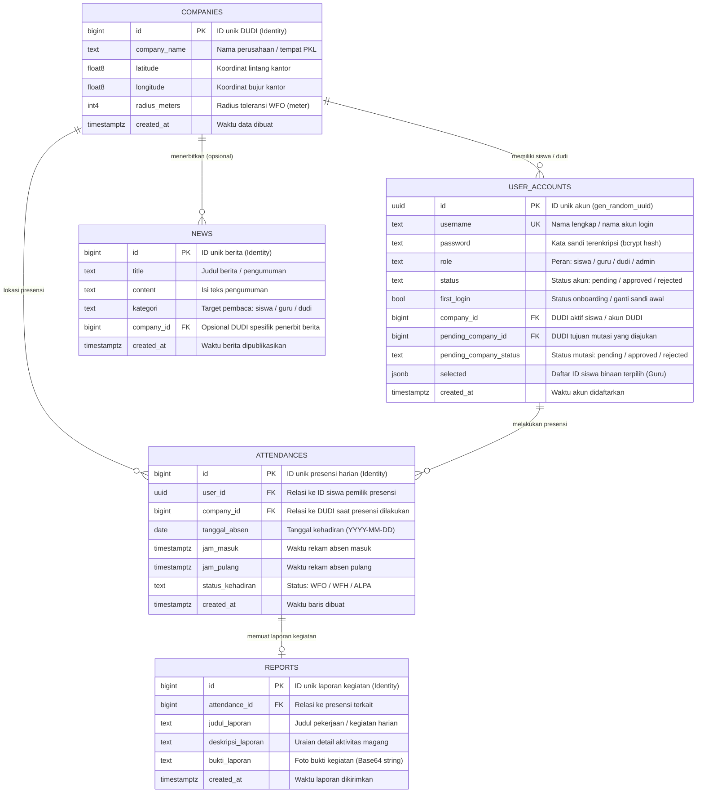
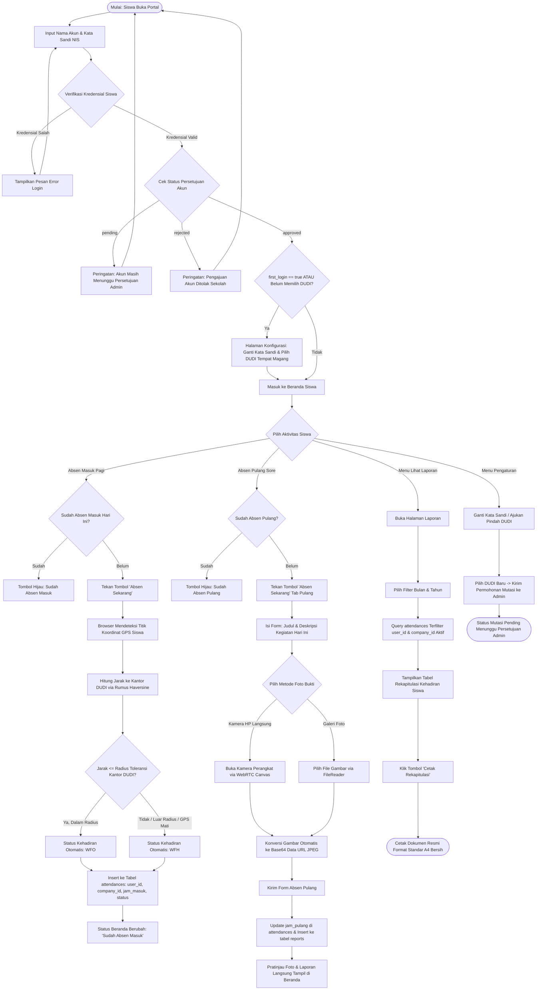
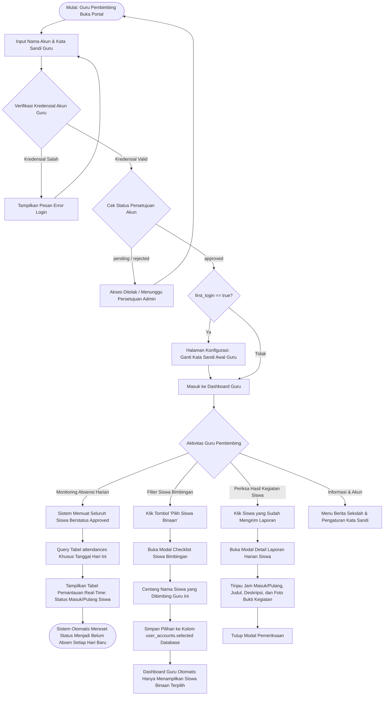
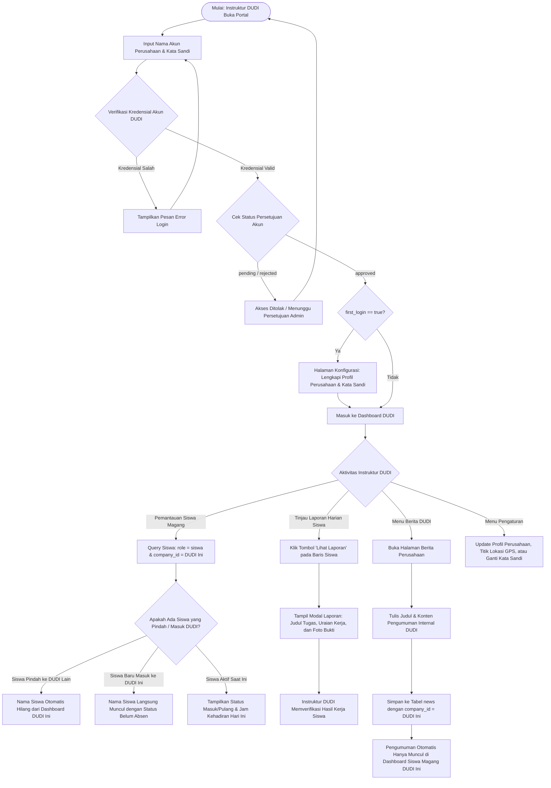

***ViskaToring — Portal Absensi Magang Siswa SMK***

**ViskaToring** adalah aplikasi web portal absensi digital untuk siswa yang sedang menjalani Praktik Kerja Lapangan (PKL/Magang). Sistem ini dirancang untuk mempermudah pencatatan kehadiran siswa, pembuatan laporan harian, serta pemantauan aktivitas oleh guru pembimbing dan pihak industri (DUDI).

>  **Live Demo:** [https://viskatoring.web.id](https://viskatoring.web.id)

---

## Fitur Utama

- **Multi-role:** Siswa, Guru Pembimbing, Instruktur DUDI, dan Admin.
- **Absensi Berbasis GPS:** Deteksi lokasi otomatis untuk menentukan status WFO (di kantor) atau WFH.
- **Laporan Harian:** Siswa wajib mengisi judul, deskripsi, dan foto bukti kegiatan saat absen pulang.
- **Rekapitulasi & Cetak:** Siswa dapat mencetak rekap absensi per bulan dalam format A4 yang rapi.
- **Manajemen Anggota:** Admin dapat mengelola seluruh akun, menyetujui pengajuan, dan mengatur DUDI.
- **Berita & Pengumuman:** Admin dan DUDI dapat menyebarkan informasi kepada siswa.
- **Isolasi Data Per DUDI:** Setiap data absensi terikat ke DUDI aktif siswa saat itu, sehingga jika siswa pindah DUDI, historis data lama tetap tersimpan dan terpisah.

---

## Teknologi yang Digunakan

| Kategori | Teknologi |
|---|---|
| Framework | [Next.js 16](https://nextjs.org) (App Router) |
| Bahasa | TypeScript |
| Styling | Tailwind CSS v4 |
| Database | [Supabase](https://supabase.com) (PostgreSQL) |
| Autentikasi | Custom bcryptjs (tanpa Supabase Auth) |
| Deployment | [Vercel](https://vercel.com) |
| Font | Host Grotesk (Google Fonts) |

---

## Akun Demo & Hak Akses


###  Siswa
| Field | Value |
|---|---|
| **Nama Akun** | `Abryan Yoga Pratama` |
| **Kata Sandi** | `17077` |

**Hak Akses Siswa:**
- Melihat dashboard beranda dengan jam realtime, statistik kehadiran WFO & WFH khusus DUDI-nya saat ini, dan pratinjau absensi hari ini.
- Melakukan **Absen Masuk** dengan deteksi GPS otomatis (WFO jika berada dalam radius DUDI, WFH jika di luar).
- Melakukan **Absen Pulang** disertai pengisian laporan kegiatan harian (judul, deskripsi, dan foto bukti dari kamera atau galeri).
- Melihat dan mencetak **Rekapitulasi Absensi** per bulan & tahun dalam format dokumen A4.
- Membaca **Berita & Pengumuman** dari sekolah dan DUDI-nya.
- Mengubah kata sandi dan mengajukan **permohonan pindah DUDI** melalui halaman Pengaturan (menunggu persetujuan Admin).

---

###  Guru Pembimbing
| Field | Value |
|---|---|
| **Nama Akun** | `Binar Aris Purwaka S.Kom` |
| **Kata Sandi** | `akubinar` |

**Hak Akses Guru:**
- Melihat **dashboard pemantauan absensi harian** seluruh siswa secara real-time (reset otomatis setiap hari).
- Memilih dan menyimpan **daftar siswa bimbingan** yang dipantau secara spesifik.
- Melihat **status kehadiran** (Sudah Masuk / Belum Absen / Sudah Pulang) beserta laporan harian, deskripsi, dan foto bukti kegiatan setiap siswa.
- Membaca berita & pengumuman dari sekolah.
- Mengubah kata sandi melalui halaman Pengaturan.

---

###  Instruktur DUDI (Enuma Technology)
| Field | Value |
|---|---|
| **Nama Akun** | `Enuma Technology` |
| **Kata Sandi** | `12345` |

**Hak Akses DUDI:**
- Melihat **dashboard kehadiran harian** seluruh siswa yang sedang magang di perusahaannya (reset otomatis setiap hari).
- Memantau status absensi siswa beserta laporan kegiatan, deskripsi, dan foto bukti.
- Memposting **Berita & Pengumuman** khusus untuk siswa magang di perusahaan tersebut.
- Mengubah kata sandi dan memperbarui data profil perusahaan melalui halaman Pengaturan.

---

###  Admin
| Field | Value |
|---|---|
| **Nama Akun** | `admin123` |
| **Kata Sandi** | `admin123` |
| **Cara Akses** | Klik logo SMK **7 kali** di halaman utama |

**Hak Akses Admin:**
- Melihat **dashboard statistik** (total siswa, guru, dan DUDI aktif) serta daftar pengajuan akun baru yang menunggu persetujuan.
- **Menyetujui atau menolak** pengajuan akun baru dari calon siswa/guru/DUDI.
- **Menyetujui atau menolak** pengajuan pindah DUDI dari siswa yang sudah aktif.
- Mengelola seluruh anggota: tambah, edit, hapus akun (termasuk fitur hapus massal siswa per tahun).
- Memposting **Berita & Pengumuman** sekolah untuk seluruh role (siswa, guru).
- Mengubah kata sandi Admin melalui halaman Pengaturan.

---

## Rancangan Database (Entity Relationship Diagram - ERD)

Aplikasi menggunakan database relasional PostgreSQL (Supabase) yang terdiri dari **5 tabel utama** yang saling berelasi:



---

### Penjelasan Relasi Antar Tabel:
1. **`companies` → `user_accounts` (One-to-Many):** Satu DUDI dapat memiliki banyak akun siswa magang dan satu akun pembimbing industri.
2. **`user_accounts` → `attendances` (One-to-Many):** Satu siswa memiliki banyak baris riwayat presensi harian.
3. **`companies` → `attendances` (One-to-Many):** Setiap baris absensi mengunci `company_id` tempat siswa magang pada hari tersebut. Hal ini menjamin bahwa jika siswa berpindah DUDI, seluruh arsip presensi DUDI lama tetap terisolasi dan tidak tercampur.
4. **`attendances` → `reports` (One-to-One):** Setiap sesi kehadiran pada hari tersebut memiliki satu laporan kegiatan harian dan foto bukti saat absen pulang.
5. **`companies` → `news` (One-to-Many, Opsional):** Berita pengumuman dapat ditujukan secara global oleh admin atau khusus siswa pada DUDI tertentu.

---

## Flowchart Alur ViskaToring

Berikut adalah diagram alir (*flowchart*) operasional sistem ViskaToring yang dibagi khusus berdasarkan 3 peran pengguna utama (**Siswa**, **Guru**, dan **DUDI**):

---

### 1. Siswa



---

### 2. Guru



---

### 3. DUDI



---

## Panduan Menjalankan di Local

### Prasyarat
Pastikan perangkat Anda sudah terinstal:
- [Node.js](https://nodejs.org) versi 18 atau lebih baru
- [Git](https://git-scm.com)
- Akun [Supabase](https://supabase.com) (gratis)

### Langkah-langkah

**1. Clone repositori ini**
```bash
git clone https://github.com/username/viskatoring.git
cd viskatoring
```

**2. Install dependensi**
```bash
npm install
```

**3. Buat file `.env.local` di root proyek**
```env
NEXT_PUBLIC_SUPABASE_URL=https://xxxxxxxxxxxxxxxxxxxx.supabase.co
NEXT_PUBLIC_SUPABASE_ANON_KEY=sb_publishable_xxxxxxxxxxxxxxxxxxxx
```
> Dapatkan nilai ini dari **Supabase Dashboard → Project Settings → API**.

**4. Siapkan database di Supabase**

Buka **SQL Editor** di Supabase dan jalankan query berikut secara berurutan:

```sql
-- Tabel companies (DUDI / Tempat Magang)
CREATE TABLE companies (
  id BIGINT GENERATED ALWAYS AS IDENTITY PRIMARY KEY,
  company_name TEXT NOT NULL,
  latitude FLOAT8,
  longitude FLOAT8,
  radius_meters INT4 NOT NULL DEFAULT 30,
  created_at TIMESTAMPTZ NOT NULL DEFAULT now()
);

-- Tabel user_accounts
CREATE TABLE user_accounts (
  id UUID PRIMARY KEY DEFAULT gen_random_uuid(),
  username TEXT NOT NULL UNIQUE,
  password TEXT NOT NULL,
  role TEXT NOT NULL DEFAULT 'siswa',
  status TEXT NOT NULL DEFAULT 'pending',
  first_login BOOL NOT NULL DEFAULT true,
  company_id BIGINT REFERENCES companies(id),
  pending_company_id BIGINT REFERENCES companies(id),
  pending_company_status TEXT,
  selected JSONB,
  created_at TIMESTAMPTZ NOT NULL DEFAULT now()
);

-- Tabel attendances
CREATE TABLE attendances (
  id BIGINT GENERATED ALWAYS AS IDENTITY PRIMARY KEY,
  user_id UUID NOT NULL REFERENCES user_accounts(id) ON DELETE CASCADE,
  company_id BIGINT REFERENCES companies(id),
  tanggal_absen DATE NOT NULL,
  jam_masuk TIMESTAMPTZ NOT NULL,
  jam_pulang TIMESTAMPTZ,
  status_kehadiran TEXT NOT NULL DEFAULT 'WFH',
  created_at TIMESTAMPTZ NOT NULL DEFAULT now()
);

-- Tabel reports
CREATE TABLE reports (
  id BIGINT GENERATED ALWAYS AS IDENTITY PRIMARY KEY,
  attendance_id BIGINT NOT NULL REFERENCES attendances(id) ON DELETE CASCADE,
  judul_laporan TEXT NOT NULL,
  deskripsi_laporan TEXT NOT NULL,
  bukti_laporan TEXT,
  created_at TIMESTAMPTZ NOT NULL DEFAULT now()
);

-- Tabel news (Berita & Pengumuman)
CREATE TABLE news (
  id BIGINT GENERATED ALWAYS AS IDENTITY PRIMARY KEY,
  title TEXT NOT NULL,
  content TEXT NOT NULL,
  kategori TEXT NOT NULL DEFAULT 'siswa',
  company_id BIGINT REFERENCES companies(id),
  created_at TIMESTAMPTZ NOT NULL DEFAULT now()
);
```

**5. Aktifkan Row Level Security (RLS)**

Agar seluruh tabel dapat diakses oleh klien menggunakan Anon Key, jalankan query berikut:

```sql
ALTER TABLE companies ENABLE ROW LEVEL SECURITY;
ALTER TABLE user_accounts ENABLE ROW LEVEL SECURITY;
ALTER TABLE attendances ENABLE ROW LEVEL SECURITY;
ALTER TABLE reports ENABLE ROW LEVEL SECURITY;
ALTER TABLE news ENABLE ROW LEVEL SECURITY;

-- Izinkan operasi SELECT, INSERT, UPDATE, DELETE untuk semua (anon)
CREATE POLICY "Allow all" ON companies FOR ALL USING (true) WITH CHECK (true);
CREATE POLICY "Allow all" ON user_accounts FOR ALL USING (true) WITH CHECK (true);
CREATE POLICY "Allow all" ON attendances FOR ALL USING (true) WITH CHECK (true);
CREATE POLICY "Allow all" ON reports FOR ALL USING (true) WITH CHECK (true);
CREATE POLICY "Allow all" ON news FOR ALL USING (true) WITH CHECK (true);
```

**6. Jalankan server pengembangan**
```bash
npm run dev
```

Buka [http://localhost:3000](http://localhost:3000) di browser Anda.

---

## Panduan Deployment ke Vercel

Aplikasi ini di-deploy menggunakan **Vercel** dengan domain kustom `viskatoring.web.id`.

### Langkah-langkah

**1. Push kode ke GitHub**
```bash
git add .
git commit -m "initial commit"
git push origin main
```

**2. Import proyek ke Vercel**
1. Buka [vercel.com](https://vercel.com) dan login.
2. Klik **Add New → Project**.
3. Pilih repositori GitHub `viskatoring` Anda.
4. Klik **Deploy** (Vercel otomatis mendeteksi Next.js).

**3. Tambahkan Environment Variables di Vercel**
1. Di dashboard Vercel → **Project Settings → Environment Variables**.
2. Tambahkan dua variabel berikut:

| Key | Value |
|---|---|
| `NEXT_PUBLIC_SUPABASE_URL` | URL Supabase project Anda |
| `NEXT_PUBLIC_SUPABASE_ANON_KEY` | Anon Key Supabase project Anda |

3. Klik **Save** lalu **Redeploy**.

**4. Hubungkan Domain Kustom `viskatoring.web.id`**
1. Di dashboard Vercel → **Project Settings → Domains**.
2. Ketik `portal-viskatoring.web.id` lalu klik **Add**.
3. Vercel akan menampilkan record DNS yang perlu ditambahkan. Salin nilainya.
4. Buka panel kontrol domain Anda (tempat membeli domain `viskatoring.web.id`).
5. Tambahkan **CNAME Record** atau **A Record** sesuai instruksi dari Vercel.
6. Tunggu propagasi DNS (biasanya 1–24 jam). Vercel akan otomatis menerbitkan sertifikat SSL (HTTPS) secara gratis.

---

## Struktur Proyek

```
viskatoring/
├── app/
│   ├── page.tsx                        # Halaman login utama (siswa & guru)
│   ├── login-admin/page.tsx            # Halaman login khusus admin (tersembunyi)
│   ├── konfigurasi-siswa/page.tsx      # Onboarding pertama kali untuk siswa
│   ├── konfigurasi-guru/page.tsx       # Onboarding pertama kali untuk guru
│   ├── konfigurasi-dudi/page.tsx       # Onboarding pertama kali untuk DUDI
│   ├── dashboard-siswa/
│   │   ├── page.tsx                    # Beranda & absensi siswa
│   │   ├── laporan/page.tsx            # Riwayat laporan & cetak rekapitulasi
│   │   ├── berita/page.tsx             # Berita & pengumuman untuk siswa
│   │   └── pengaturan/page.tsx         # Ganti kata sandi & ajukan pindah DUDI
│   ├── dashboard-guru/
│   │   ├── page.tsx                    # Pemantauan absensi siswa harian
│   │   ├── berita/page.tsx             # Berita untuk guru
│   │   └── pengaturan/page.tsx         # Pengaturan akun guru
│   ├── dashboard-dudi/
│   │   ├── page.tsx                    # Pemantauan siswa magang harian
│   │   ├── berita/page.tsx             # Berita dari & untuk DUDI
│   │   └── pengaturan/page.tsx         # Pengaturan akun DUDI
│   └── dashboard-admin/
│       ├── page.tsx                    # Dashboard statistik & persetujuan akun
│       ├── kelola-anggota/page.tsx     # Manajemen seluruh anggota
│       ├── berita/page.tsx             # Manajemen berita sekolah
│       └── pengaturan/page.tsx         # Pengaturan akun admin
├── supabase/
│   ├── client.ts                       # Inisialisasi Supabase client
│   ├── auth.ts                         # Fungsi autentikasi (hash, verify, session)
│   ├── types.ts                        # TypeScript interface untuk seluruh tabel
│   └── helpers.ts                      # Fungsi pembantu (GPS, format tanggal)
└── public/
    ├── smk.svg                         # Logo SMK (favicon)
    └── halaman depan.webp              # Foto latar halaman login
```

## Screenshot tampilan website

---

**Login**
1. Global (Kecuali Admin)

2. Admin


---

**Konfigurasi**
1. Siswa

2. Guru dan DUDI


---

**Dashboard**
1. Siswa

- Model Pop Up Absen Masuk

- Model Pop Up Absen Pulang

2. Guru

- Model Pop Up Filterisasi

- Model Pop Up Lihat Laporan Siswa

3. DUDI

- Model Pop Up Lihat Laporan Siswa

4. Admin

- Model Pop Up Persetujuan Anggota Baru

- Model Pop Up Pengajuan Perubahan Dudi


---

**Kelola Anggota**
1. Admin

- Model Pop Up Tambah Anggota

- Model Pop Up Edit Anggota


---

**Laporan**
1. Siswa

- Model Print Laporan


---

**Berita**
1. Siswa

2. Guru

3. DUDI

- Model Pop Up Tambah berita

4. Admin

- Model Pop Up Tambah berita Siswa dan Guru


---

**Pengaturan**
1. Siswa

2. Guru

3. DUDI

4. Admin

